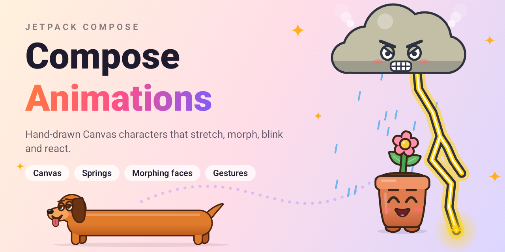
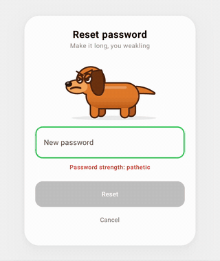
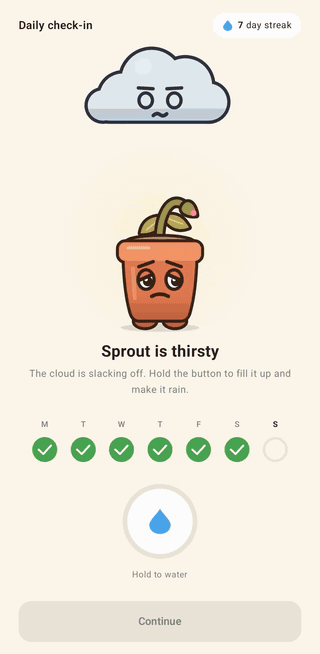

<p align="center">
  
</p>

# Compose Animations

Animation practice in Jetpack Compose, mostly characters drawn by hand on a `Canvas`.
Every demo lives in its own module, and a small showcase app lists them all so you can try each one.

## Demos

<table>
  <tr>
    <td align="center"></td>
    <td align="center"></td>
  </tr>
  <tr>
    <td align="center"><b>Forget password</b></td>
    <td align="center"><b>Daily check-in</b></td>
  </tr>
</table>

| Demo | What it does | Code |
|---|---|---|
| Forget password | A dachshund that stretches as your password grows. Its face morphs with the password strength, from grumpy to shocked to tongue out, and its tail wags faster as it gets happier. | [`demos/forgetpassword`](demos/forgetpassword), [`characters/dog`](characters/dog) |
| Daily check-in | Sprout, a wilting potted seedling, waits under a lazy storm cloud for today's habit check-in. Hold the button and a jet of water shoots up into the cloud: it swells, gets furious and storms, with rain, lightning, screen flashes and rumbles, while Sprout drinks and perks up in springy gulps. When the ring fills, Sprout blooms and jumps for joy, the cloud cheers up and drifts off, and a wave of tiny flowers rolls across the screen. Let go too early and Sprout sulks. | [`demos/dailycheckin`](demos/dailycheckin), [`characters/sprout`](characters/sprout), [`characters/stormcloud`](characters/stormcloud) |

## Run it

1. Open the root folder in Android Studio.
2. Run the `app` configuration.
3. Tap a demo to open it. Back returns to the list.

Requires Android 7.0 (API 24) or newer.

## Record the previews

The GIFs and the cover above are recorded from the real app, not edited by hand:

```bash
scripts/record-demos.sh                  # the cover and every demo
scripts/record-demos.sh dailycheckin     # just some demos
ANDROID_SERIAL=<serial> scripts/record-demos.sh   # pick a phone when several are connected
```

It needs `adb`, `ffmpeg` and a phone connected with USB debugging (it never starts an emulator). It installs the debug app, opens each demo from the list, plays it with real taps and typing while `screenrecord` runs, and writes `docs/media/<demo>.gif` with the system bars cropped off. Before every tap or keystroke it checks that the app has focus, so input never lands in another app.

The cover comes from `CoverActivity`, which exists only in debug builds. It draws the characters at exactly 1280 × 640, GitHub's social preview size, and saves a PNG. To use it as the repo's link preview, upload `docs/media/cover.png` under **Settings → General → Social preview**.

## Project structure

```
app/                  Showcase app: the demo list
characters/           Reusable Canvas characters. They only draw, and know nothing about any screen.
  dog/                The stretchy dachshund: drawing, expressions, wag and blink
  sprout/             The potted seedling: drawing, expressions, fidgets and the cheer hop
  stormcloud/         The storm cloud with a temper: swelling, rain, lightning, floating away
demos/                Full screens built around the characters
  forgetpassword/     Reset-password card with the dog
  dailycheckin/       Habit check-in with Sprout, the storm cloud and a hold-to-water button
build-logic/          Gradle convention plugins shared by the modules
scripts/              record-demos.sh: records the README's GIFs and cover
docs/media/           The README's GIFs and cover
```

Dependencies go one way: `app → demos → characters`. A character can be reused by any number of demos.

## Add a new animation

1. **Character (optional).** Create `characters/<name>/build.gradle.kts`:
   ```kotlin
   plugins { alias(libs.plugins.composeanimations.character) }
   android { namespace = "com.zobaer53.composeanimations.characters.<name>" }
   ```
2. **Demo.** Create `demos/<name>/build.gradle.kts`:
   ```kotlin
   plugins { alias(libs.plugins.composeanimations.demo) }
   android { namespace = "com.zobaer53.composeanimations.demos.<name>" }
   dependencies { implementation(project(":characters:<name>")) }
   ```
   Expose one public `@Composable` entry point that sets its own `MaterialTheme`.
3. **Register it.**
   - In `settings.gradle.kts`, add `include(...)` for each new module.
   - In `app/build.gradle.kts`, add `implementation(project(":demos:<name>"))`.
   - In [`Demos.kt`](app/src/main/java/com/zobaer53/composeanimations/Demos.kt), add a `Demo(...)` entry.
4. **Preview.** In [`scripts/record-demos.sh`](scripts/record-demos.sh), add the demo's slug to `DEMOS`, its list title to `title_of`, and a `scenario_<slug>` function that plays it. Run `scripts/record-demos.sh <slug>` and add the GIF to the gallery above.

## Credits

The forget-password demo is a Compose recreation of a dachshund password animation by Ramin Nasibov.

Sprout and the storm cloud are original characters. The idea of a mascot that reacts to a hold-to-charge moment came from César Álvarez's article on app mascots.
